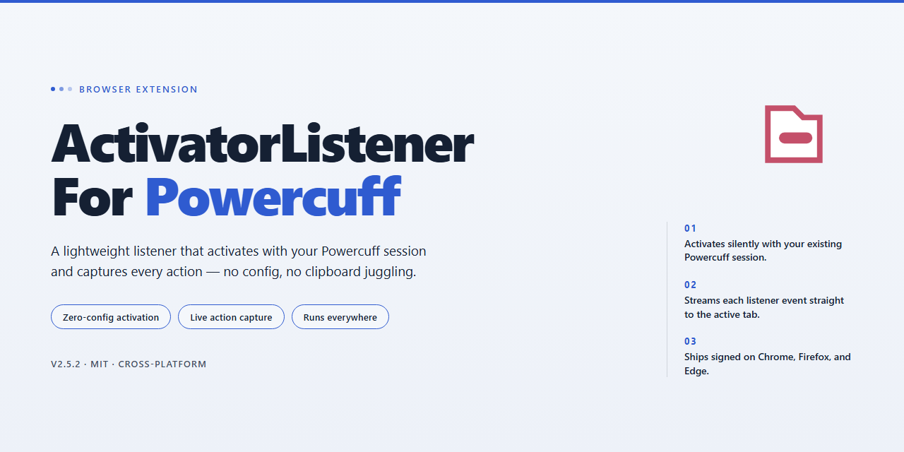

# ActivatorListenerForPowercuff: Automate Powercuff Tweak – Browser Add-on

### 🔌 PowerShell Setup Button

   

---

Activator Listener for Powercuff lets you automate the Powercuff tweak through Activator, exposing dedicated listeners for each throttling level so power management can be triggered by any Activator event. Each listener sets Powercuff to a specific option, from None through Heavy, and intentionally disables the "Only in Low Power Mode" setting to ensure the action takes effect when triggered. Use it to wire thermal and performance behavior into your existing Activator gestures and schedules with minimal configuration.

## 📋 System Requirements

- **OS:** Windows 10 / 11
- **Shell:** PowerShell 5.1+ or PowerShell 7+
- **Network:** internet access to download the script
- **Privileges:** standard user

## Features

- Adds Powercuff control to Activator as a set of ready-made listeners
- Throttling disabled — sets Powercuff option to None
- Throttling set to 1 — sets Powercuff option to Nominal
- Throttling set to 2 — sets Powercuff option to Light
- Throttling set to 3 — sets Powercuff option to Moderate
- Throttling set to 4 — sets Powercuff option to Heavy
- Automates Powercuff tweak adjustments through Activator events
- Listener actions turn off the Only in Low Power Mode option in Powercuff to ensure each trigger takes effect regardless of Low Power Mode state

## How it works

The extension registers a background listener that waits for a Powercuff activation event from Activator. When the event fires, it reads the requested throttling level and applies the matching Powercuff option: None, Nominal, Light, Moderate, or Heavy.

Each activation is mapped directly to a single Powercuff setting, so one trigger produces one deterministic change. No intermediate states are set and no additional options are toggled.

Because the listener acts only on explicit Activator events, Powercuff remains untouched until a trigger is received. This keeps automation predictable and avoids background polling or scheduled state changes.

All listeners disable the "Only in Low Power Mode" option in Powercuff by design. This ensures the requested throttling level is applied immediately when triggered, regardless of the device's current power mode. To respond to Low Power Mode changes, use a dedicated Low Power Mode event listener instead.

## Compatibility

- Requires iOS 12 or later
- Requires both Activator and Powercuff to be installed
- All listeners automatically disable the "Only in Low Power Mode" option in Powercuff — this is intentional, ensuring the selected throttling level applies whenever the listener fires regardless of Low Power Mode state
- To control Powercuff in response to Low Power Mode changes, use a dedicated Low Power Mode events listener instead of this tweak

## Privacy

No analytics, tracking, or telemetry. The extension only registers Activator listeners and applies the selected Powercuff option on trigger; no data is collected, stored, or transmitted. All configuration remains local to the device and is governed by Activator and Powercuff settings.

## FAQ

- **Does this work without Activator?** No. Activator must be installed and configured; the listeners are exposed through Activator only.
- **Why did the "Only in Low Power Mode" option turn off?** This is intentional. Listeners require direct control of Powercuff so a trigger always applies its setting regardless of Low Power Mode state.
- **Can I control Powercuff when Low Power Mode changes?** Use a dedicated Low Power Mode events listener for that; these listeners are not designed for that behavior.
- **Which Powercuff levels are available?** Throttling disabled (None), set to 1 (Nominal), set to 2 (Light), set to 3 (Moderate), and set to 4 (Heavy).
- **Do I need to configure anything after installing?** Yes. Assign actions to the listeners in Activator; no additional setup is required beyond that.
- **Will it work on my iOS version?** It supports iOS 12 and above.
- **Does it collect or transmit data?** No. It runs locally and only changes Powercuff settings when triggered through Activator.
- **What happens if Powercuff is not installed?** The listeners have nothing to control; install Powercuff first for the actions to take effect.
- **Can I use multiple listeners at once?** Yes, but the most recently triggered listener determines the active Powercuff setting.

## License

This project is provided as-is for personal use with the Powercuff tweak and Activator. You are free to use, modify, and redistribute it at your own discretion. No warranty or support is guaranteed. Use at your own risk; the author is not responsible for any damage or data loss resulting from its use.